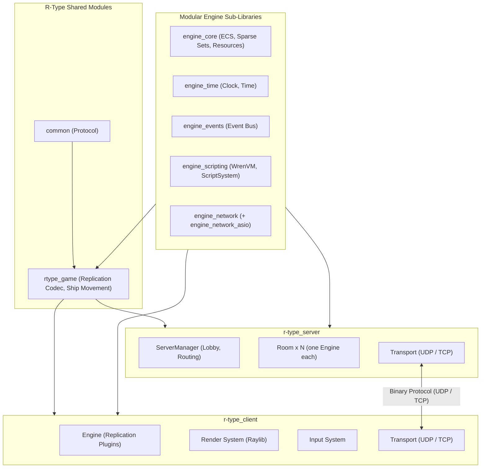
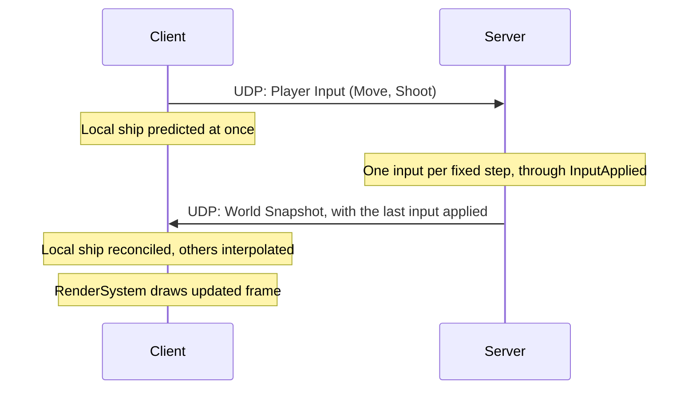

# Architecture Overview

## 1. High-Level Architecture

The project is structured into three primary tiers:

1. **Modular Engine:** An agnostic standalone set of link-time sub-libraries and plugins. Every engine name lives under the root namespace `sq` (`sq::ecs::Registry`,
   `sq::events::EventBus`, `sq::net::NetworkPlugin`, `sq::time::Clock`...), so it never collides with a game's own names:
    - **`engine_utils`**: helpers with no dependency: move-only callables, stable id slots, portable path handling.
    - **`engine_core`**: Lightweight ECS Core (Registry, Sparse Arrays, Entity, CommandBuffer, Resources), central **
      `Engine`** coordinator, **`Mediator`** service registry, and **`PluginGraph`** dependency resolver.
    - **`engine_time`**: Fixed-timestep simulation clock (`Clock`), time data (`Time`), and monotonic time providers.
    - **`engine_events`**: Decoupled message passing interface (`EventBus`). The events of a module live in that module
      (`systems/physics/PhysicsEvents.hpp`, `ui/UiEvents.hpp`, ...).
    - **`engine_scripting`**: Embedded Wren virtual machine, runtime scripting system (`ScriptSystem`), and
      `ScriptPlugin`. Depends on core, events and log only; bridges plug the other modules in:
      `engine_input_scripting` (`core/Input`), `engine_prefabs_scripting` (`Engine.spawnPrefab`),
      `engine_physics_scripting` (`onCollision`), `engine_scene_scripting`, `engine_assets_scripting`.
    - **`engine_render_api`**: header-only and headless: render data components (`Renderable`, `CameraComponent`,
      `Hidden`, ...) and the window, input-code, input-capture, render and screen-draw service interfaces. A headless
      server sets render data and the UI draws through these interfaces without linking raylib.
    - **`engine_render` **: Raylib-backed windowing and rendering (`RenderPlugin`), which also translates engine input codes for its backend.
   - **`engine_input`**: Backend-agnostic input mapping (`InputPlugin`) sampling hardware through `IWindowService`.
    - **`engine_physics`**: Box2D rigid body simulation plugin (`PhysicsPlugin`).
    - **`engine_network`**: Transport interfaces (`INetworkServer`, `INetworkClient`), `NetworkConfig`, `NetworkPlugin` and
      the replication plugins (snapshots, input queue, prediction, interpolation), around a codec provided by the game.
      No Asio.
    - **`engine_network_asio`**: Asio implementation of the transport, created through `sq::net::createServer()` /
      `createClient()`.
    - **`engine_metrics`**, **`engine_metrics_overlay`**, **`engine_network_metrics`**: in-game measures on a
      `MetricsBoard` (frame rate, process, then network), and the HUD panel showing them. See
      [In-Game Metrics](metrics.md).
    - **`engine_prefabs`**: Named entity template registry plugin (`PrefabPlugin`).
    - **`engine_all`**: Meta/phony target building all engine sub-components together.

    Components, events and service interfaces live next to the module that owns them; `engine_core` knows nothing of
    audio, input or windows (`Engine::run()` stops on `Engine::stop()`, which the render plugin calls when its window
    closes). `scripts/check_module_boundaries.py --strict` (CI) checks that each module only includes headers of its
    own module and of its `add_deps`.
2. **Authoritative Server:** Hosts game simulation sessions, one `sq::engine::Engine` per room, runs logical systems, enforces
   validation, and synchronizes states.
3. **Graphical Client:** Renders the world, handles local inputs, and queries user devices. Interpolation and client-side
   prediction come from the engine's replication plugins.

Between the engine and the executables, two R-Type modules are shared by the server and the client:

- **`common`**: the protocol alone (Protobuf schema and codec). It does not depend on the engine.
- **`rtype_game`**: what needs both the engine and the protocol: the replication codec, and the ship movement both sides must
  compute the same way.

## 2. Client-Server Synchronization Model

The game follows an **Authoritative Server** architecture:

- **Client:** Captures player input and sends it across UDP datagrams. It renders local feedback and reconciles
  discrepancies when server updates arrive.
- **Server:** Runs at a fixed simulation tick rate, advances the game state, handles collision and damage calculations,
  and sends each player a snapshot of its room.

